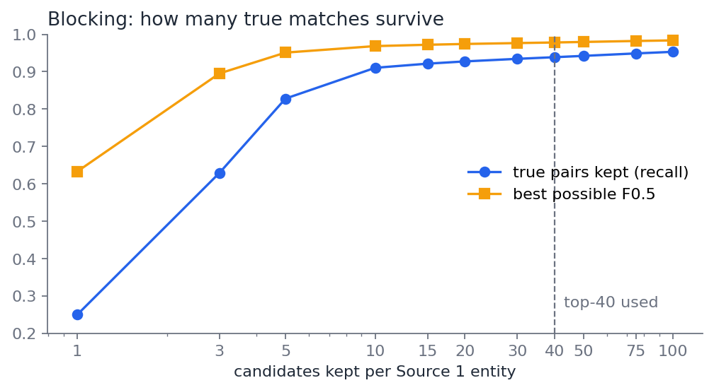
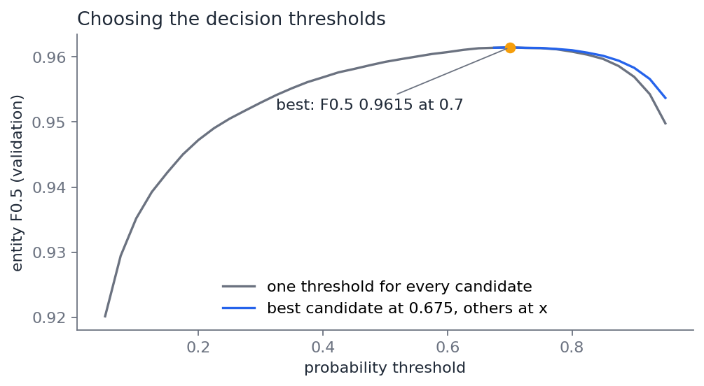
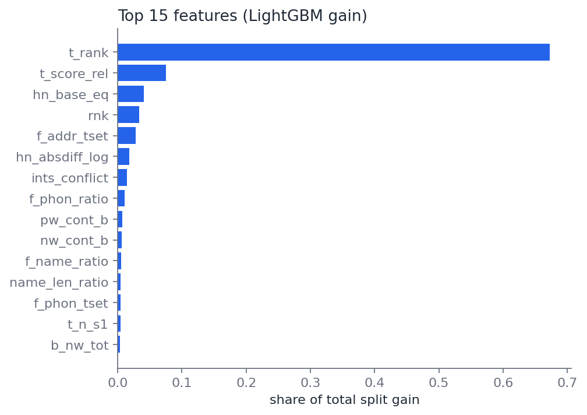
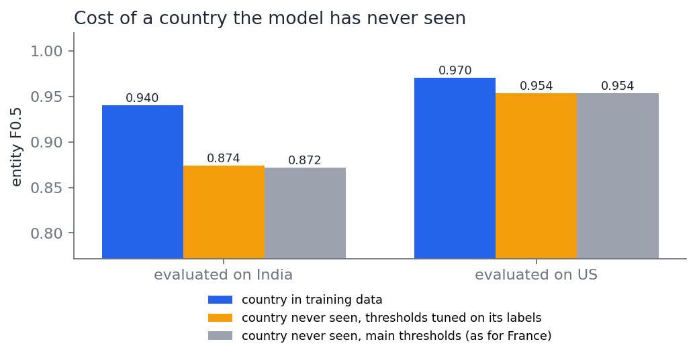

# Business Entity Resolution at scale

Matching noisy business records across three sources with blocking, fuzzy and phonetic features, and a LightGBM pair classifier. Built on the **Amazon ML Challenge 2026** dataset (12.5 million training records, 11.7 million test records, US + India, plus France at test time only).

| | Result (held-out validation) |
|---|---|
| **Entity-level F0.5** | **0.9615** |
| Precision / recall | 0.9905 / 0.9136 |
| Blocking: candidate pairs vs. all same-country pairs | 88 M vs. 11.8 trillion (reduction ratio 0.999993) |
| Blocking recall (true pairs kept in the top 40) | 93.9% |
| Country never seen in training (France is test-only) | F0.5 0.954 on US, 0.872 on India (vs. 0.970 / 0.940 when seen) |

## The problem

Source 1 is a deduplicated list of businesses. Sources 2 and 3 contain noisy copies of those businesses (and look-alikes that are *not* the same business). For every Source 1 business, find all Source 2/3 records that refer to it.

The score is the mean over Source 1 businesses of F0.5, which weights precision twice as much as recall: linking two different businesses costs more than missing a link. A business with no true matches scores 1 only if nothing is predicted for it.

## What the data looks like

| | Source 1 | Source 2 | Source 3 |
|---|---|---|---|
| train | 2,206,821 | 5,034,616 | 5,285,603 |
| test | 1,732,544 | 4,887,273 | 5,082,316 |

Findings from the labels (7.6 M true pairs) that drove the design:

- **Every Source 2/3 record belongs to at most one Source 1 business** (0 exceptions). A record can therefore be given to its single most likely business.
- **Businesses have 3.5 matches on average**; only 5.6% have none.
- **26% of Source 2/3 records match nothing.** They are near-duplicate distractors: same name in another town, or same street with a house number a few digits off (`Zasoft, LLC, 290 10th Circle` vs. `Zasoft, Co, 295 10RD CIR`).
- **Heavy noise**: 28% of Indian Source 2 names are written in Devanagari, Tamil, Telugu, Bengali or other scripts (`इंडियन केयर प्राइवेट लिमिटेड` = Indian Care Private Limited); names get extra words, 'trading as' trade names, typos, glued words (`indiancare.com`); addresses get reordered, abbreviated, numbers changed, state names swapped for codes or local script, and 3% are empty.
- Matched records always share the country label, so comparisons stay within a country. France has no training data, so nothing in the pipeline is keyed on the country name.

## Approach

```
TSV ─► normalise ─► blocking (10 key families, top-40 per business) ─► 75 pair features ─► LightGBM ─► decision rule ─► matches
       names,        88 M candidate pairs out of 11.8 trillion           string, IDF overlap,  binary       exclusivity +
       addresses                                                         numbers, ranking      classifier   threshold
```

### 1. Normalisation (`src/normalize.py`)
- Unicode NFKC, transliteration of any script to ASCII, lowercase.
- Hand-written abbreviation tables: legal forms (Private→pvt, Limited→ltd, SARL, LLC…), street types (Road→rd, Rue, Boulevard…), US and Indian state names→codes, directions.
- 'X trading as Y' / 'dba' names are split so either part can match.
- **Phonetic skeleton** for transliterated names: sound-alike letters merged, vowels and doubled letters dropped, so `praaivett limittedd` and `private limited` both become `prwt lmt`. On 3,000 true pairs with an Indian-script name, the share of pairs with fuzzy similarity ≥ 80 rose from **29% to 90%**.
- House numbers kept as separate tokens (compound forms like `5-7-142/ep` stay whole).

### 2. Blocking (`src/blocking.py`)
Comparing every pair is impossible (11.8 trillion same-country pairs in training). Each record gets keys from ten families: name word, phonetic name word, address word pair, name word + address word, whole name, whole phonetic name, name without spaces, name word + house number, address word + house number. A key is used only if it is rare (≤ 200 target records; ≤ 1,000 for whole-name keys). Candidates are scored by the summed IDF of the keys they share, and the 40 best per business are kept.

Combining keys mattered: name words alone recover only 44% of true pairs (the dataset reuses brand words), name + address word keys 79%, all ten families together 97.8% before the top-40 cut.

| candidates kept per business | 5 | 10 | 20 | **40** | 100 |
|---|---|---|---|---|---|
| true pairs kept | 82.8% | 91.0% | 92.7% | **93.9%** | 95.3% |
| best possible F0.5 | 0.951 | 0.968 | 0.974 | **0.978** | 0.984 |



### 3. Pair features (`src/features.py`, 75 features)
- **String similarity** (RapidFuzz): ratio, token-sort, token-set, partial ratio, Jaro-Winkler on names; the same on phonetic names, names without spaces, 'trading as' variants and addresses.
- **IDF-weighted word overlap** for name words, phonetic words and address words (containment both ways, weighted Jaccard), with IDF computed within each country.
- **House numbers**: same number, any shared number, conflicting numbers, and integer comparisons that tolerate leading zeros (`00419`), suffixes (`3008-A`) and ranges (`637-641`), plus the numeric gap between the two numbers (distractors are usually a few digits off).
- **Context**: rank of the candidate among its business's candidates, and the rank of the business among all businesses competing for the same record (`t_rank`).
- Flags: target name in a non-Latin script, target address missing, source.

### 4. Model (`src/train.py`)
LightGBM binary classifier on 26 M labelled candidate pairs from a 30% sample of training businesses. Validation holds out 20% of those businesses with all their pairs (grouped split), and counts every held-out business, including those whose matches were lost in blocking. Easy non-matches are downsampled to 25% and weighted ×4 so probabilities stay calibrated.

### 5. Decision rule
1. **Exclusivity**: a Source 2/3 record is only kept for the business that gives it the highest probability.
2. A candidate is a match if its probability ≥ threshold. The threshold is chosen by maximising entity F0.5 directly on the validation set (a separate, lower threshold for each business's best candidate was also searched; it did not help).

## Results

Validation: 132,341 held-out training businesses (all their pairs unseen in training), scored end to end, including matches lost in blocking.

| | F0.5 | Precision | Recall |
|---|---|---|---|
| v1: 68 features | 0.9563 | 0.9895 | 0.9029 |
| **v2: + 7 integer house-number features** | **0.9615** | **0.9905** | **0.9136** |
| perfect classifier on the same candidates (blocking ceiling) | 0.9775 | 1.0000 | 0.9371 |

| v2 by country | F0.5 | Precision | Recall |
|---|---|---|---|
| US | 0.9726 | 0.9937 | 0.9325 |
| India | 0.9448 | 0.9857 | 0.8854 |

India is harder: more names in non-Latin scripts and house numbers that change between sources even for the same business.

v2 came from the v1 error analysis: 62% of false links and 60% of missed links involved house numbers, often the same number written differently (`00419` / `419`, `3008-A` / `3008`, `637-641` / `637`) or a distractor a few digits away (`B-86` / `B-88`). Comparing house numbers as integers, plus the size of the gap, cut missed links by 31% and false links by 9%.

Test set: 1,732,544 Source 1 businesses (including 259,452 in France), 69.0 M candidate pairs scored, 5.56 M links predicted; the output passes every format rule.




**The most useful single feature is `t_rank`**: among all businesses competing for a record, is this the strongest one? It works because each record has exactly one owner, which the labels confirm.

### Does it work on a country it has never seen?
France appears only in the test set. To estimate the cost of an unseen country, the model was trained without India and evaluated on India (and the same for the US), compared with a model of the same size that did see the country:

| evaluated on | country in training | never seen, thresholds tuned on its own labels | **never seen, main thresholds** |
|---|---|---|---|
| US | 0.970 | 0.954 | **0.954** (−1.7) |
| India | 0.940 | 0.874 | **0.872** (−6.8) |

All four models use the same amount of training data (4 M pairs), so the gap is the cost of the unseen country, not of less data.

- **The threshold transfers**: tuning it on the unseen country's own labels gains only 0.002, so having no French labels costs almost nothing there.
- **The data does not fully transfer**: a model that never saw India loses 6.8 points on it, through both precision (0.93 vs. 0.98) and recall (0.82 vs. 0.88), because Indian records carry noise the US has little of (scripts, house numbers that change between sources). A model that never saw the US loses only 1.7 points.
- **For France** the submitted model was trained on both countries, i.e. on a wider mix of noise than either single-country model here, so its drop on France is expected to sit at the lower end of this range, but the honest expectation is a score below the validation 0.96.



### Where it still fails ([full report](reports/error_analysis.md))
On the validation businesses (v2):

| | links |
|---|---|
| correct | 418,453 |
| false (predicted, not a match) | 3,676 |
| missed, although a candidate | 10,655 |
| missed, lost in blocking | 28,548 |

- **Blocking misses are now the largest loss** (2.7x the classifier's misses). 29% have a target name in a non-Latin script and 30% a target with no address, so there is very little shared text to block on, e.g. `Seven Foundation Limited` vs. `செவன் ஃபவுண்டேஷன் லிமிடெட்` with a partial address.
- **Renamed records**: some copies carry an unrelated trade name (`Wilmington Quality Newbridge LLC` vs. `Xylobrix`, same address). Only the address can link them, so the model is rightly cautious.
- **False links** are mostly distractors that differ only in a house number or a missing address: `CC Feeds Private Limited, B-86, Okhla` vs. `CC Feeds Limited, B-88, Okhla`.

## Output

`src/predict.py` writes the two challenge files to `output/`; `src/validate_submission.py` checks every rule from the problem statement (one row per test business, only existing Source 2/3 ids, no duplicates, matches ⊆ candidates).

## Run it

```bash
python -m venv .venv && .venv/bin/pip install -r requirements.txt
# place the challenge files in data/raw/train/ and data/raw/test/
PY=.venv/bin/python ./run_all.sh
```
Runs on a 16 GB laptop (about 2 hours end to end on an Apple M4): DuckDB spills to disk instead of holding the 200 M-row joins in memory, and features are computed in chunks of 1.1 M pairs.

## Project layout

```
src/
  load.py               TSV -> Parquet
  normalize.py          name/address normalisation, phonetic key
  prepare.py            normalise all records in parallel
  blocking.py           candidate generation (DuckDB)
  blocking_report.py    blocking recall / ceiling by top-K
  features.py           pair features (DuckDB + RapidFuzz)
  metric.py             entity-level F0.5
  train.py              LightGBM, grouped validation, threshold search, leave-one-country-out
  predict.py            test predictions -> output/*.tsv
  validate_submission.py
  error_analysis.py, figures.py
notebooks/walkthrough.ipynb   the whole project in one notebook
reports/                      blocking.json, validation.json, error_analysis.md, figures/
```

## Notes

- Libraries: DuckDB, pandas, LightGBM, RapidFuzz, scikit-learn (all MIT/BSD/Apache). Transliteration uses Unidecode (GPL-2.0); AnyAscii (ISC) is a permissive drop-in alternative.
- No external data (registries, geocoders) is used; abbreviation tables are written by hand.
- Data comes from a public Kaggle copy of the challenge files (`gowthamdd/amazon-ml-challenge-2026`); the challenge test labels are not public, so all scores here are on held-out training businesses.

## What I would try next

- A second-stage model that uses first-stage probabilities of competing pairs (the strongest signal is already 'who else wants this record').
- A learned ranking for blocking: 1.4% of true pairs sit between rank 41 and 100.
- Better transliteration for Tamil and Malayalam, where letters are dropped by generic transliteration.
- French address abbreviations (`R.` for *Rue*), since France was never seen in training.
